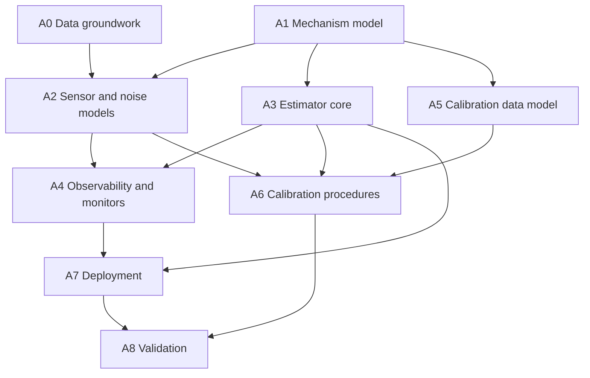

# State estimation and calibration: plan index

This directory holds the plan for the machine's state estimator and its
calibration. It is an **application** plan. It was written alongside the
`rtt3` framework plan in [../rtt3/](../rtt3/README.md) but does not
depend on it, and is kept separate so that it can be moved to the
application's own project. Nothing here is specific to the framework
beyond the short list under "What this asks of a host framework".

Status: proposal. No code exists. The content is standard estimation
and calibration practice applied to what the owner has stated about the
machine. None of it has been tested on the machine, no measurement has
been made, and statements about third-party tools and instruments
(SymForce, KDL, GNSS receivers, inertial units, total stations) are from
general knowledge.

## What is known about the system

Stated by the owner; everything else in these documents is proposal.

- The machine is a chain of five or six bodies, each a pose in SE(3),
  with far fewer true degrees of freedom; the mechanism is approximately
  planar.
- One inertial unit per link, sampled at about 100 Hz.
- GNSS with velocity output; carrier-phase corrections often but not
  always available; two antennas on some configurations only.
- Sensor covariances vary at run time.
- Out-of-plane vibration grows with link length, and disturbances
  propagate at finite speed.
- Gyroscope bias changes extremely slowly, and leaving it out of the
  estimation has worked better than estimating it.
- Eigen is the linear-algebra library; SymForce is planned for
  closed-form kinematics; the simulator is a block graph with MuJoCo.
- There are many machine sizes, types and sensor stacks. Some machines
  provide joystick input or pilot valve rates; main valve pressure or
  force is rarely available. Lidar surface data exists for some
  recordings. The examples given include an articulated chain and a
  dozer.
- A tracking total station with prisms is available; lock-on time is a
  problem; calibration without the instrument is a goal.

## Decisions recorded

| Topic | Decision |
|---|---|
| Estimator | A truncated factor graph (fixed-lag smoother), not a pure EKF and not a cascade |
| State | The mechanism's true degrees of freedom, not a pose per link |
| Sensor trust | A sensor is trusted less the further it is along the chain from the joint in question, through a disturbance that accumulates link by link; no structural or modal model by default |
| Observability | Low curvature of the residual along a direction is the indicator |
| Calibration | The same factor graph, with each parameter given a role (fixed, considered, calibrated off line, tracked on line) |
| Kinematics | Generated from one symbolic model; the planar restriction is an assumption on the model, not separate code |
| Numerics | Performance first; agreement with the simulator within tolerance |
| Learned models, if used | Trained only on the residuals of the kinematic and sensor models; soil and actuation parts independent of machine type |

Proposed and awaiting confirmation: gyroscope bias as a considered
parameter anchored at stillness; a GNSS offset state with two position
outputs, local and global; the nested "nothing moved" levels in the
calibration data model.

## Files

| File | Content | Streams |
|---|---|---|
| [kinematics.md](kinematics.md) | Closed-form kinematics generated from a symbolic model; planar and full variants; migration from KDL | A1 |
| [state-model.md](state-model.md) | Lie group states and error conventions; reduction to the true degrees of freedom; the gyroscope worked case; joint filter versus cascade | A1 |
| [sensor-models.md](sensor-models.md) | Distance-dependent trust; link vibration; propagation delay and sampling; the 100 Hz inertial units and GNSS; accelerometer inclination and stillness; GNSS coloured noise; bias handling | A0, A2 |
| [estimator.md](estimator.md) | The windowed solver; time grid and pre-integration; marginalising the oldest state; observability from curvature | A3, A4 |
| [contact-detection.md](contact-detection.md) | Evaluation: inferring tool contact from changes in vibration behaviour, and the more direct alternatives; sudden loss of contact; a dozer blade passing over a hole and anticipating the body's dip | X1 |
| [learned-dynamics.md](learned-dynamics.md) | Evaluation: JEPA and dimensionless-group networks for dynamic quantities the kinematic model does not observe; soil and actuation models shared across machine types, with the mechanism model between them; lidar as a training reference | X3 |
| [filter-numerics.md](filter-numerics.md) | **Deferred.** Cost and numerical form of Kalman-style updates; factored and mixed-precision forms. Reopened only if a higher sensor rate is adopted | X2 |
| [calibration.md](calibration.md) | Parameter roles; batch calibration; external observations; single-joint sweeps; total station use; calibration without it; validation poses | A5, A6 |
| [calibration-data.md](calibration-data.md) | Record types for observations; linked observations; surface offsets; plane heading and the "nothing moved" levels; dependency graph and invalidation | A5 |
| [questions.md](questions.md) | Open points for the owner | - |

## Work streams

| Stream | Content | Depends on | Exit criterion |
|---|---|---|---|
| **A0** Data groundwork | Synchronised recording of all inertial units, GNSS and commands with trustworthy time stamps; check of anti-alias and output settings; long stationary recordings; sensor noise characterisation | - | A recording set from which correlation times, bias stability and sampling skew can be measured |
| **A1** Mechanism model | Symbolic description of bodies, joints, reference points and planes; generated kinematics and Jacobians, full and planar; the off-line observability (rank) tool | - | Generated kinematics agree with the existing implementation within tolerance; rank tool reports the degrees of freedom |
| **A2** Sensor and noise models | Inertial model with lever-arm terms and Earth rate; GNSS position, velocity and offset model; the accumulated disturbance with coherence; noise parameters fitted by likelihood | A0, A1 | Innovations on recorded data are white and correctly scaled |
| **A3** Estimator core | Fixed-structure block-tridiagonal solver; time grid and pre-integration; marginalisation with frozen linearisation points; bounded iteration | A1 | With a window of one it reproduces a reference EKF; with linear models it reproduces the Kalman filter for any window |
| **A4** Observability and monitors | Curvature along candidate directions; parity residual; leakage and whiteness monitors; stillness detection | A2, A3 | Weak directions and unexplained motion are reported correctly on simulated cases with known answers |
| **A5** Calibration data model and tool | Record types, links, dependency graph and event log; session planning from predicted information | A1 | A recorded session can be stored, invalidated in part, and re-solved reproducibly |
| **A6** Calibration procedures | Batch solve over a session; static poses; single-joint sweeps; total-station and instrument-free procedures; validation pose selection | A2, A3, A5 | Injected errors in simulation are recovered within reported uncertainty; a reference and a field calibration of one machine agree |
| **A7** Deployment | The estimator on the target: predictor in the control thread, solver beside it; local and global outputs; per-machine calibration values | A3, A4, and a host framework | Runs on the target within its time budget with no allocation in the control thread |
| **A8** Validation | Closed-loop simulation with the plant model; recorded-data regression; field validation at the poses of largest predicted error | A6, A7 | Accuracy and honesty of uncertainty meet the specification |

### Exploratory and deferred

These are not on the path to a working estimator and gate nothing.

| Stream | Content | Depends on | Outcome |
|---|---|---|---|
| **X1** Contact detection | Evaluate whether free and contact conditions are distinguishable in the inertial data; for the stated use, sudden loss of contact and overshoot compensation, measure the time budget and which signals detect the release soonest; prototype off line; fuse with force and actuation cues | A0 for recordings; A2 for the vibration model | A go or no-go from recorded data, then a contact probability usable by A2 and A3 |
| **X3** Learned dynamic information | Establish which dynamic quantities are observable at all; virtual sensors against temporary reference sensors; dimensionless formulation; JEPA pre-training as a research comparison | A0 for recordings; a test machine with reference sensors | Per quantity, a decision on whether a learned estimate is worth integrating, and at what level |
| **X2** Filter arithmetic | Structure, factorisation and precision measures for a faster or larger filter | A decision to raise the inertial sample rate | Not scheduled |

X1 covers two stated uses with very different time budgets: a sudden
loss of contact, where the response must come within tens of
milliseconds, and a dozer blade passing over a hole, where the body
reaches the hole a second or so later and its dip can be anticipated
from a remembered surface profile.

X1 and X2 are linked: a positive result from X1, or a need for modal
vibration states, is what would justify a higher inertial rate, and that
is what would reopen X2.

## Dependencies

## What can run in parallel

| When | Side by side |
|---|---|
| Immediately | **A0**, **A1**, and the record types of **A5** (which need only the names from A1, not its generated code) |
| After A1 | **A3** and the rest of **A5**, while A0 continues |
| After A0 and A1 | **A2** |
| After A2 and A3 | **A4** and **A6** |
| After A3 and A4 | **A7**, alongside A6 |
| After A6 and A7 | **A8** |
| Any time after A0 | **X1**, step 1 (looking at recordings), and **X3**, steps 1 to 3, independently of everything else |

As tracks that different people could own:

- **Data and sensors**: A0, then A2.
- **Model and estimator**: A1, then A3, then A4.
- **Calibration**: A5, then A6.
- **Integration**: A7 and A8.

The longest chain is A1, A3, A4, A7, A8. A0 is not on it but is the
stream most likely to hold things up, because it needs the machine.

## What this asks of a host framework

The estimator and the calibration tool are written as plain functions
over plain data types, so they can run in the simulator, in a test
program, or on the target. On the target they need from whatever
framework hosts them:

- a control-rate thread that may not allocate or block, for the
  predictor, and a lower-priority thread for the solver, with a
  latest-value hand-over between them;
- sensor and command data delivered with time stamps taken at the
  source;
- recording of all of it with those time stamps;
- per-machine configuration values with uncertainties, loaded at
  start-up and changeable between cycles;
- a way to select a sensor set per machine configuration (one or two
  GNSS antennas).

In the `rtt3` plan these correspond to the thread fold and channels,
port observation and logging, the machine file and tunable properties,
and slots. The existing RTT 2.x deployment can provide the same with
separate activities, buffered ports and properties, so this plan does
not have to wait for `rtt3`.

## Things outside the streams that gate them

| Input | Needed for | Why |
|---|---|---|
| Access to the machine for recordings | A0 | Everything about noise rests on measured data |
| Sensor identities and settings (inertial units, receiver) | A0, A2 | Anti-alias filters, time stamping, receiver output filtering |
| Existing kinematics and estimator code | A1, A3 | Reference for agreement tests |
| Accuracy specification | A6, A8 | Decides whether instrument-free calibration is sufficient |
| Total station export format and time stamps | A5, A6 | Raw angles and lock status are preferred |
| Whether the base moves, and antenna layout | A1, A2 | Changes the root of the mechanism model and heading observability |
