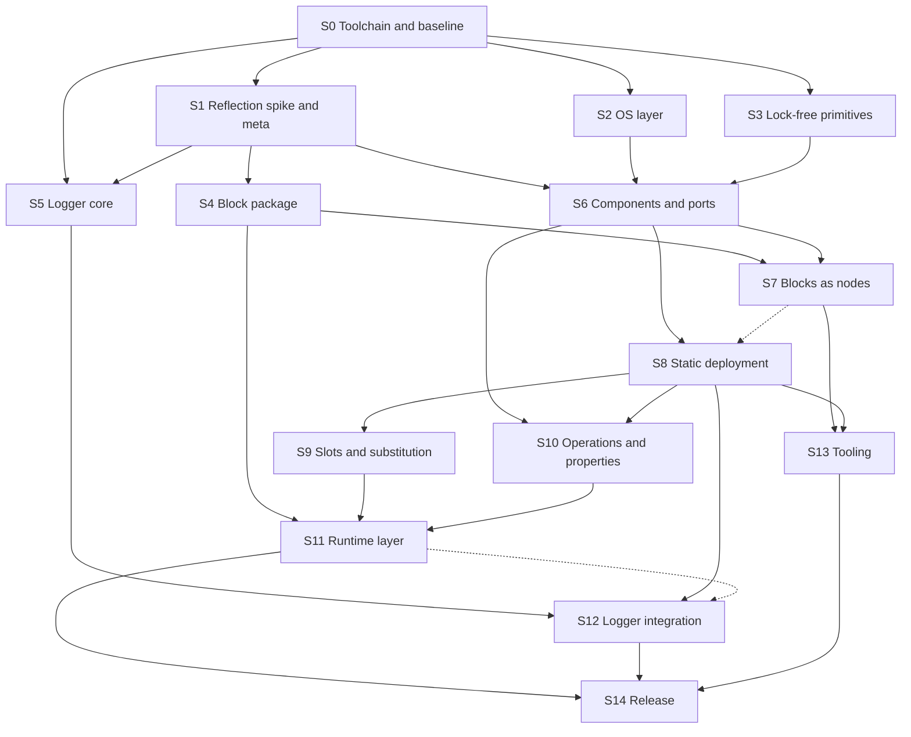

# rtt3 plan: index

`rtt3` is the planned successor to RTT 2.x in this fork. This directory
holds its plan, one file per topic. This page lists the files, then the
stages of work, what each stage depends on and which stages can be done
in parallel.

Status: proposal. No `rtt3` code exists yet. Nothing here has been built
or measured, and the GCC 16 features the design relies on have not been
tried on a real compiler; stage S1 exists to do that first.

## Files

| File | Content | Stages |
|---|---|---|
| [overview.md](overview.md) | Decisions taken, state of the existing code, approach, libraries, naming, risks | all |
| [conventions.md](conventions.md) | Error handling with `std::expected`; macro policy; registration without macros | all |
| [toolchain-and-build.md](toolchain-and-build.md) | GCC 16, CMake, cross toolchain, CI, benchmarks | S0 |
| [reflection.md](reflection.md) | What is used from C++26 reflection and how the dependency is contained | S1 |
| [os-layer.md](os-layer.md) | Threads, clocks, locks and memory on Linux; ARM specifics | S2 |
| [realtime-internals.md](realtime-internals.md) | Lock-free primitives; cache behaviour; context switches; allocation; system calls; file I/O and priority inversion | S3, and rules for all real-time code |
| [blocks.md](blocks.md) | Portable functions shared with the simulator; the neutral block package; C functions | S4, S7 |
| [logging.md](logging.md) | Lock-free logger, with its own steps L0 to L6 | S5, S12 |
| [components-and-ports.md](components-and-ports.md) | Components as plain structs, ports, port data concepts, link adaptors | S6 |
| [deployment.md](deployment.md) | Deployment as a struct, the per-thread fold, same-thread links, slots, substitutable links | S8, S9 |
| [operations-and-properties.md](operations-and-properties.md) | Annotated operations and properties, typed callers | S10 |
| [runtime-layer.md](runtime-layer.md) | Machine files, graph model, inspection, port observation, UDP bridge, loading | S11 |
| [compile-time.md](compile-time.md) | What is computed or checked during compilation, further opportunities, limits | S1, S8, all |
| [numerics.md](numerics.md) | SIMD, alignment, floating-point state, Eigen, comparing with the simulator | S4, S6, S7 |
| [questions.md](questions.md) | Open design questions M1 to M23 | - |

Related documents outside this directory:
[../open-questions.md](../open-questions.md) (all open points in priority
order, the licence position, unverified assumptions) and
[../optimisation-plan.md](../optimisation-plan.md) (the existing RTT 2.x
code, independent of everything here).

## Stages

Each stage ends with its tests passing on x86-64 and AArch64.

| Stage | Content | Depends on | Exit criterion |
|---|---|---|---|
| **S0** Toolchain and baseline | Pinned GCC 16 image (native and AArch64 cross), CMake skeleton and CI beside the old tree, benchmark harness, RTT 2.x baseline numbers on desktop and ARM board | - | Reproducible baseline; empty `rtt3` libraries build and install next to RTT 2.x |
| **S1** Reflection spike and `rtt3/meta` | Conformance tests for every reflection feature the design uses; the internal module that turns declarations into constant tables; the logger's call-site technique (L1) | S0 | Every feature confirmed on the real compiler, or the affected design revised |
| **S2** OS layer | `rtt3::os`: threads, clocks, priority-inheritance locks, memory locking, graceful downgrade, start-up report, simulated clock, allocation guard and system call filter for tests | S0 | Thread, timing and lock tests pass; wake-up latency measured on the ARM board |
| **S3** Lock-free primitives and channels | Data object, triple buffer, sequence lock, single-producer ring, multi-writer queue, block pools | S0 | Stress and model-checking tests pass on both architectures |
| **S4** Block package | The neutral, dependency-free package: block description from a function, annotation types, boundary types and Eigen adaptor, schema and hash, wire encoding | S1 | A block from the simulator is described without edits; encode and decode round-trip on both architectures |
| **S5** Logger core | Per-thread rings, record encoding, drain thread, console sink, level filtering (L0 to L2) | S0, S1 | Logging from a real-time thread passes the allocation guard and system call filter |
| **S6** Components and ports | Component concept, ports, port data concepts, policies, `connect`, activities, lifecycle, error type | S1, S2, S3 | Hand-wired example runs; port latency no worse than baseline |
| **S7** Blocks as nodes | `function_node`, state and parameter handling, time step, finite check | S4, S6 | A portable block runs unchanged in the simulator and as a node |
| **S8** Static deployment | Deployment struct, validation, per-thread fold and same-thread links, channel selection, minimal machine file, graph model specification and `--graph` export, `run` | S6 (S7 for the fold tests with blocks) | Example system runs with zero allocations after start-up; fold checks report the cost of same-thread links |
| **S9** Slots and substitutable links | Install-time alternatives, link substitution, disabled nodes, `--check` | S8 | One binary runs with a real and a simulated hardware alternative selected by file |
| **S10** Operations and properties | Annotated operations and properties, `uses`, completion handlers, validation, tunable properties | S6, S8 | Operation call cost no worse than baseline |
| **S11** Runtime layer | Full machine files, names, served graph, inspection service and client library, port observation, UDP bridge, registrar and loader, converter for deployer XML and `.cpf` | S4, S8, S9, S10 | A simulator stand-in drives substituted links over UDP and an inspection client maps the graph and observes ports, as separate processes; an RTT 2.x and an `rtt3` component load into one process |
| **S12** Logger integration | Rings tied to node threads, machine-file settings, spdlog adapter, flight recorder, crash dump, live tail (L3 to L6) | S5, S6, S8; L6 also S11 | Real-time and spdlog messages appear in one stream; crash test passes |
| **S13** Tooling | `rtt3-gen` from an exported graph, subsystems, single-process closed-loop test with a plant block | S7, S8 | A controller graph exported by the simulator becomes a running deployment without hand-editing |
| **S14** Release | Migration guide with a worked port of a real component, API and ABI policy, removal of the old `rtt/` tree | all | Tagged 3.0 |

## Dependencies

A dotted arrow is a partial dependency: the later stage can start without
the earlier one but cannot finish (S8's fold tests want blocks from S7;
the logger's live tail, L6, wants the inspection service from S11).

## What can run in parallel

| When | Stages that can proceed side by side |
|---|---|
| After S0 | **S1**, **S2**, **S3**. They share nothing but the toolchain. S5 can begin its ring and drain thread, which need no reflection |
| After S1 | **S4** and the rest of **S5**, alongside S2 and S3 if those are still running |
| After S1, S2 and S3 | **S6**. This is the first point where the tracks join |
| After S6 | **S7** and **S8** together (S7 also needs S4) |
| After S8 | **S9**, **S10**, **S13** and the L3 part of **S12** |
| After S9 and S10 | **S11** |
| After S11 | The rest of **S12**, then **S14** |

Seen as tracks that different people could own:

- **Platform**: S2 and S3, then joins at S6.
- **Reflection and blocks**: S1, then S4, then S7. S4 is also the part the
  simulator can start using before any framework code exists.
- **Logging**: S5 early, S12 late. Useful to every other track once S5 is
  done.
- **Framework**: S6, S8, then S9 and S10, then S11.

The longest chain, and so the one that sets the earliest finish, is
S0, S1, S6, S8, S9, S11, S14.

## Things outside the stages that gate them

| Input | Needed before | Why |
|---|---|---|
| Licence decision for `rtt3` | S3 and S6 | Both are where existing algorithms would be carried over. Whether RTT 2.x sources may be consulted depends on the licence chosen ([../open-questions.md](../open-questions.md), section 4) |
| A GCC 16 toolchain for AArch64 and an ARM reference board | S0 exit | Baseline numbers and every later "both architectures" criterion |
| The simulator's block wrapper, or example blocks | S4 | Its conventions are to be adopted as they are |
| The deployer extension and its wire encoding | S9 design, S11 | Specification for link substitution and the UDP bridge |
| Answers on lifecycle and operation threading (M2, M3) | S6, S10 | They fix the node state machine and the call model |
| Answers on variation and tooling (M11) | S9, S11 | Whether slots are enough, and what the inspection service must offer |
| AArch64 only or ARMv7 as well (M5) | S3 | Changes the design of the lock-free primitives |

S0, S1, S2 and S5 depend on none of these and can start now, subject to
the licence point if any RTT 2.x code is to be reused in S2.

## Cross-cutting rules

These are not stages; every stage that puts code on a real-time path has
to meet them, and the test tools that enforce them come from S2.

- No allocation, lock, formatting, file I/O or system call on the update
  path beyond the thread's periodic sleep
  ([realtime-internals.md](realtime-internals.md)).
- No exceptions from `rtt3`; no macros in the user-facing API
  ([conventions.md](conventions.md)).
- No framework overhead where none is required. Same-thread links costing
  what an inlined call costs is a design goal with a documented fallback,
  not a hard requirement ([deployment.md](deployment.md)).
- Performance first in numerics; agreement with the simulator within
  tolerance ([numerics.md](numerics.md)).
